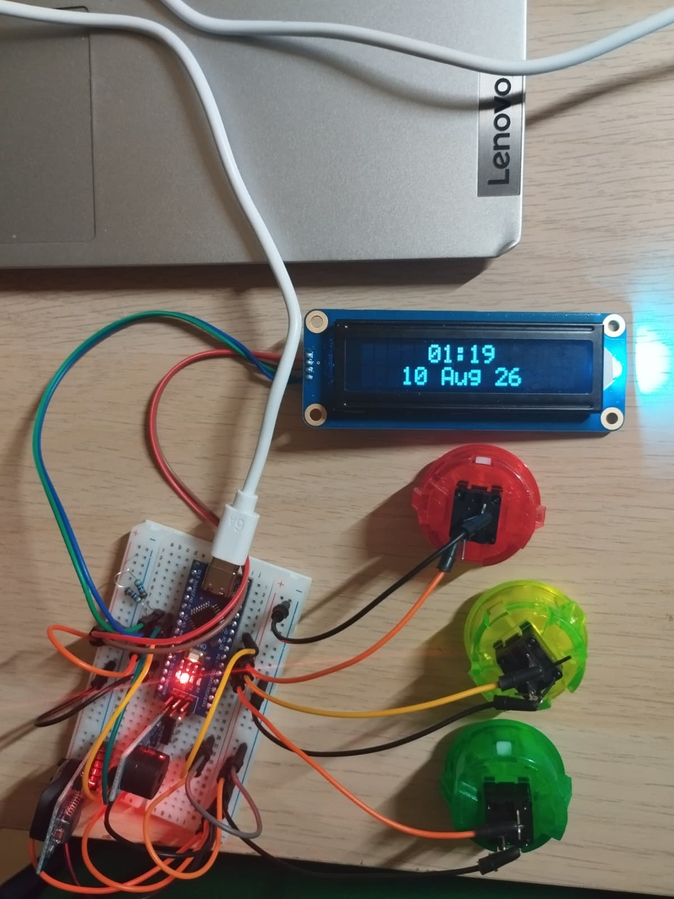

# **Traffic Light Desk Timer [WIP]**
A traffic-light-themed desk clock and timer that tracks study sessions, with a countdown timer for exam practice.

## **States**
clock: displays current time.\
 

current session: stopwatch for tracking study time in current session.\

time today: displays total accumulated study time for the day, updates live.\

exam mode: countdown timer for practice tests.

## **User Navigation**

## **Bill of Materials**
| Item | Qty | Unit Cost (USD) | Total Cost (USD) | Source |
| --- | --- | :---: | :---: | --- |
| Arduino Nano V3 CH340 | 1 | 1.82 | 1.82 | Taobao: 深圳市轩特佳电子
| 30mm Arcade Button (Red) | 1 | 0.28 | 0.28 | Taobao: 华宇动漫三和清水
| 30mm Arcade Button (Yellow) | 1 | 0.28 | 0.28 | Taobao: 华宇动漫三和清水 
| 30mm Arcade Button (Green) | 1 | 0.28 | 0.28 | Taobao: 华宇动漫三和清水
| LCD 1602 Display with I2C (White Text on Black Backlight) | 1 | 2.51 | 2.51 | Taobao: 深佳显LCD液晶屏
| Buzzer module | 1 | 0.50 | 0.50 | Taobao: risym旗舰店
| DS3231 AT24C32 Module with I2C | 1 | 1.27 | 1.27 | Taobao: 一越电子
| 4.7k Ohm Resistor | 2 | 0.0034 | 0.0068 | Taobao: 海雀数码专营店
| Solderless Breadboard Half Size | 1 | 0.20 | 0.20| Taobao: 深圳市育松创达电子有限公司

**Total Cost: 7 USD (to nearest dollar)**
