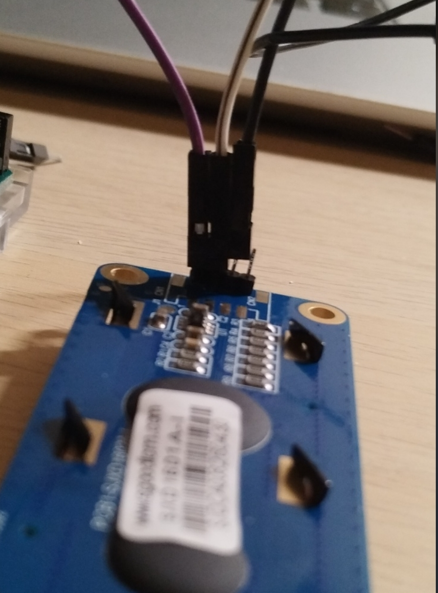
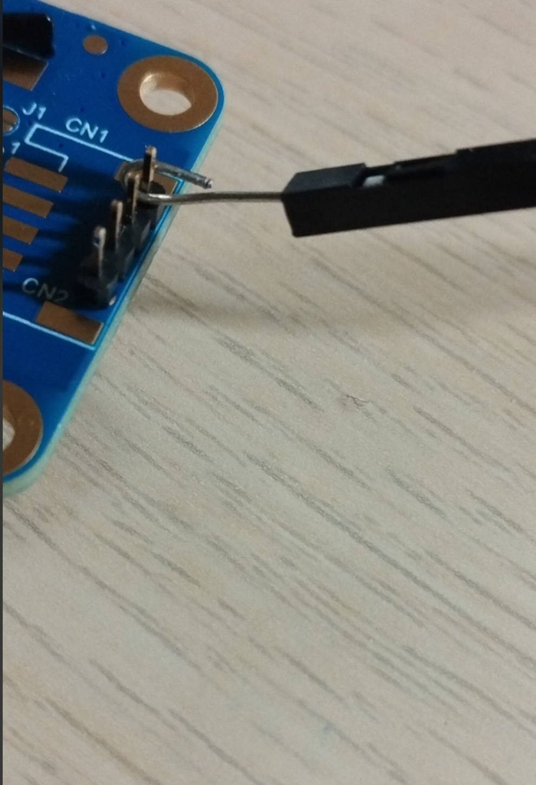
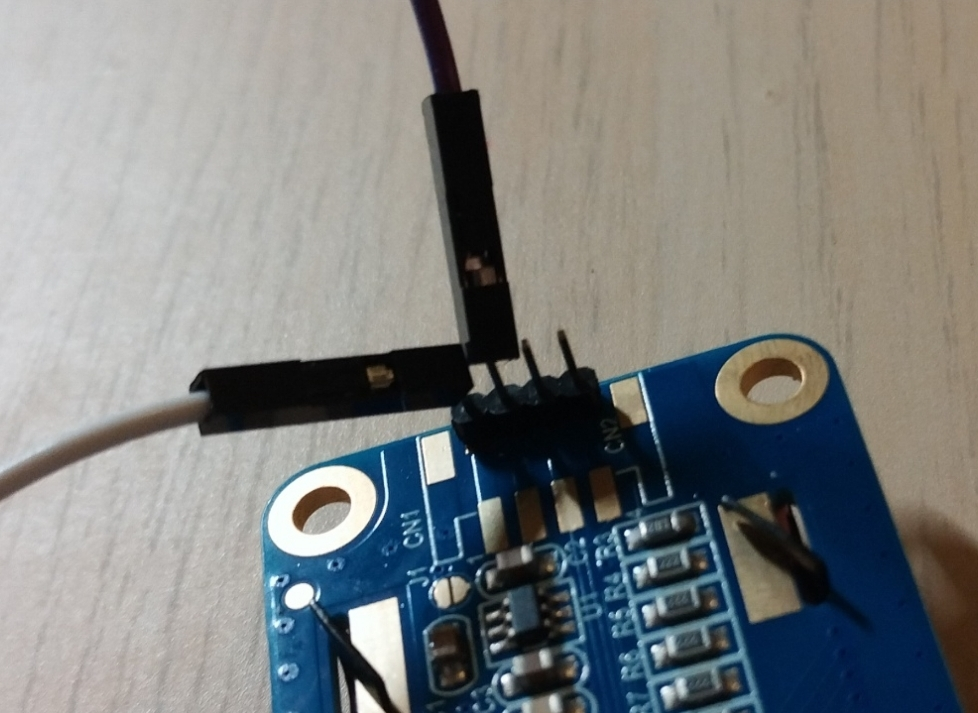
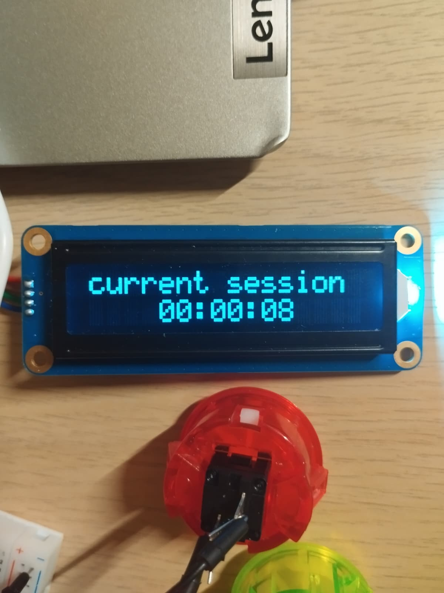
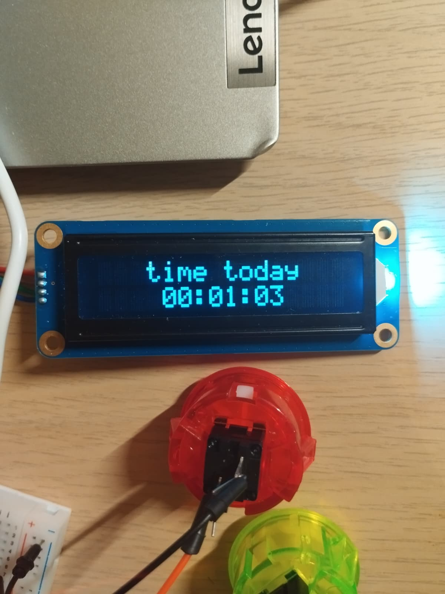
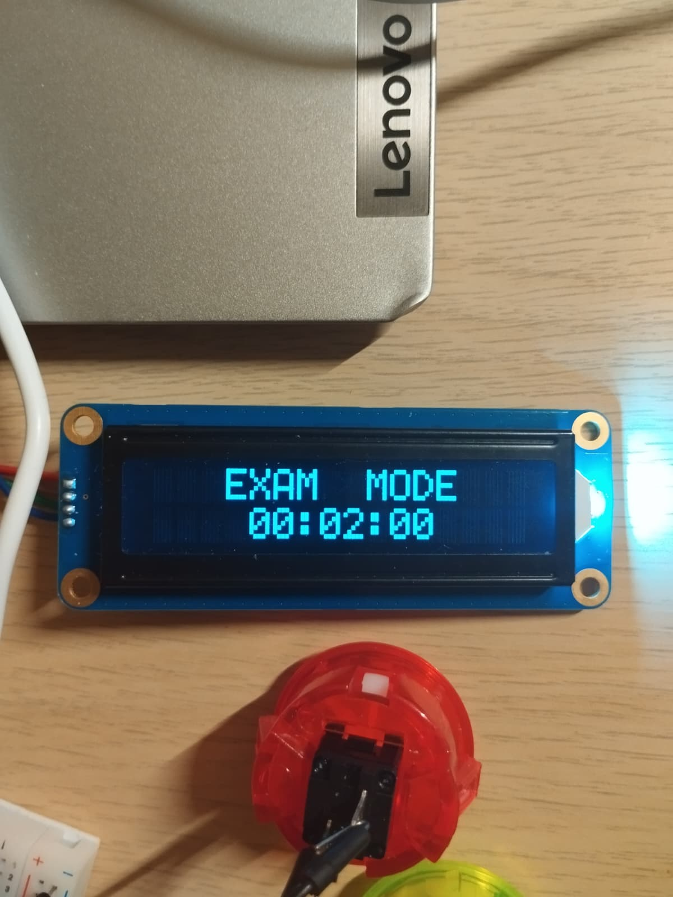
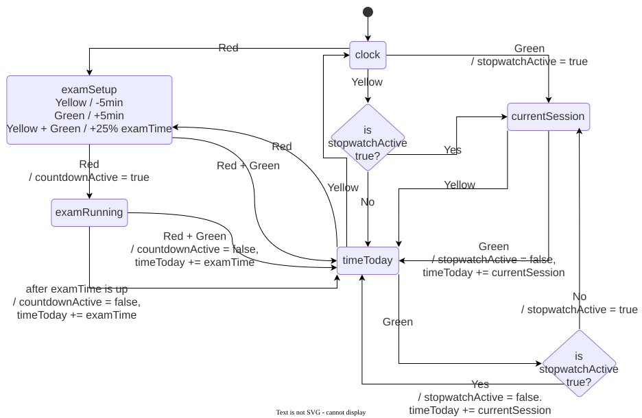

# **Traffic Light Desk Timer**
This is a traffic-light-themed desk clock and timer that tracks study sessions, with a countdown timer for exam practice.

I liked using the [YPT app](https://www.yeolpumta.com/en/) to track my study time, but hated having my phone around while I studied, so I decided to build a hardware project that could do the same thing.

I originally wanted to build a macropad that was linked to the YPT API so I could remotely access the app's features, but upon realizing YPT does not have a public API, I decided to ditch it altogether and build a standalone hardware device.

> This is my first hardware project, and first time writing C++. I learned a lot about state machine logic, I2C, PWM, electrical noise... 
> the importance of reading datasheets... the fact that different pin pitches exist... 
> 
 
>    
 do have to apologise to my jumper wires for that 

>    
>   
>   
> 

## **Features**
clock: displays current time.\
 

current session: stopwatch for tracking study time in current session.\

time today: displays total accumulated study time for the day, updates live.\

exam mode: countdown timer for practice tests.\

## **User Navigation**
The desk timer is controlled using a 3-button interface (Red, Yellow and Green).
### Standard Mode
**Green:** Starts the stopwatch (i.e. tracking a new study session). Stops session if pressed again.\
**Yellow:** Cycles display view between clock, your current session (if active) and your total time studied today.\
**Red:** Enters exam setup mode.
### Exam Mode
**Adjust Exam Duration** [in Setup Mode]:
- **Green:** + 5min
- **Yellow:** - 5min
  

**Add 25% Extra Time** [in Setup Mode]: Press **Yellow** and **Green** at the same time.

**Start Exam**: Press **Red**.

**Escape**: Press **Red** and **Green** at the same time.

    
View full user navigation flowchart

        

## **How to Set Up**
- Build your circuit according to the [schematic](hardware\circuit-schematic.pdf)
- Flash the firmware to your Nano. Make sure to uncomment [the RTC clock synchronization code](https://github.com/jamrock-shuffle/traffic-light-desk-timer/blob/75cabc53190b753a74b939d7437aed82e2967f3c/firmware/src/main.cpp#L31) (NB: make sure to comment it back out after your first upload!)

## **Bill of Materials**
| Item | Qty | Unit Cost (USD) | Total Cost (USD) | Source |
| --- | --- | :---: | :---: | --- |
| Nano V3 CH340 | 1 | 1.82 | 1.82 | Taobao: 深圳市轩特佳电子
| 30mm Arcade Button (Red) | 1 | 0.28 | 0.28 | Taobao: 华宇动漫三和清水
| 30mm Arcade Button (Yellow) | 1 | 0.28 | 0.28 | Taobao: 华宇动漫三和清水 
| 30mm Arcade Button (Green) | 1 | 0.28 | 0.28 | Taobao: 华宇动漫三和清水
| LCD 1602 Display with I2C (White Text on Black Backlight) | 1 | 2.51 | 2.51 | Taobao: 深佳显LCD液晶屏
| Buzzer module | 1 | 0.50 | 0.50 | Taobao: risym旗舰店
| DS3231 AT24C32 Module with I2C | 1 | 1.27 | 1.27 | Taobao: 一越电子
| 4.7k Ohm Resistor | 2 | 0.0034 | 0.0068 | Taobao: 海雀数码专营店
| Solderless Breadboard Half Size | 1 | 0.20 | 0.20| Taobao: 深圳市育松创达电子有限公司

**Total Cost: 7 USD (to nearest dollar)**
